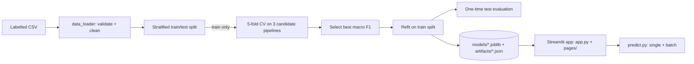

# SentimentAI

Classify review text as **Positive**, **Negative** or **Neutral** with a TF-IDF + scikit-learn pipeline and explore it in a Streamlit dashboard. Everything runs locally: no API keys, no external services.

## Problem statement
Businesses receive thousands of free-text reviews. Reading them all is impractical, so SentimentAI scores them automatically, shows the overall sentiment mix, and reports honestly how well the model performs.

## Features
- Real-time single-review analysis with model-estimated probabilities
- CSV batch analysis (column selection, preview, summary, charts, CSV download)
- Reproducible training: stratified split, cross-validated comparison of 3 models, one-time test evaluation
- Model performance page driven by generated artifacts (never hard-coded numbers)
- Session-only prediction history (in memory, lost on refresh)
- Data-quality reporting (missing text, duplicates, conflicting labels, class imbalance)
- Automated tests (pytest, including headless Streamlit page tests)

## Technology stack
Python 3.11+, scikit-learn, pandas, NumPy, Streamlit, Plotly, Joblib, pytest. NLTK is intentionally **not** used: the vectorizer's built-in tokenizer plus a small standard-library normaliser keeps negations intact and avoids tokenizer downloads that could be missing at run time.

## Architecture


## Project structure
```
SentimentAI/
├── app.py                  # dashboard (home)
├── pages/                  # Analyze Text, Batch Analysis, Model Performance, About
├── config/settings.py      # paths, limits, constants
├── src/
│   ├── preprocessing.py    # single normalize_text used by training AND inference
│   ├── data_loader.py      # CSV loading, validation, cleaning, upload parsing
│   ├── train.py            # candidates, cross-validation, selection, final fit
│   ├── evaluate.py         # metrics
│   ├── predict.py          # SentimentPredictor, batch prediction, CSV export
│   ├── model_utils.py      # save/load artifacts (atomic writes)
│   ├── visualization.py    # Plotly figures
│   ├── app_helpers.py      # cached model loading, session history
│   └── demo_data.py        # synthetic generator (demo + tests only)
├── scripts/                # prepare_data.py, train_model.py
├── tests/                  # pytest suite
├── data/{raw,processed}/   # your datasets (git-ignored); see data/README.md
├── models/                 # sentiment_pipeline.joblib (generated)
├── artifacts/              # metrics.json, model_metadata.json (generated)
├── requirements.txt  pytest.ini  .gitignore  .env.example  LICENSE
└── .streamlit/config.toml
```
(`src/app_helpers.py` and `src/demo_data.py` were added to the suggested layout so UI glue stays testable and tests/demo share one generator.)

## Windows setup (PowerShell)
```powershell
# 1. Install Python 3.11+ from python.org (tick "Add python.exe to PATH"), then:
cd C:\path\to\SentimentAI

# 2. Create and activate a virtual environment
py -3.11 -m venv .venv
.\.venv\Scripts\Activate.ps1

# 3. Install dependencies
python -m pip install --upgrade pip
python -m pip install -r requirements.txt
```
If activation is blocked by the execution policy, either run
`Set-ExecutionPolicy -Scope CurrentUser RemoteSigned` once, or skip activation and prefix every command with the venv's Python:
```powershell
.\.venv\Scripts\python.exe -m pip install -r requirements.txt
.\.venv\Scripts\python.exe -m streamlit run app.py
```

## Prepare data
See [data/README.md](data/README.md). Quick start with the **synthetic demo set** (demonstrates the software, not accuracy):
```powershell
python scripts/prepare_data.py --demo
```
With a real dataset:
```powershell
python scripts/prepare_data.py --input data\raw\my_reviews.csv --text-column reviewText --rating-column overall
```
Required canonical schema: `text,sentiment` (labels `positive|negative|neutral`).

## Train the model
```powershell
python scripts/train_model.py --data data\processed\reviews.csv
# demo data:
python scripts/train_model.py --data data\raw\demo_reviews.csv
```
Outputs:

| File | Content |
|---|---|
| `models\sentiment_pipeline.joblib` | full fitted Pipeline (TF-IDF + classifier) |
| `artifacts\metrics.json` | validation comparison + held-out test metrics |
| `artifacts\model_metadata.json` | model name, seed, dataset sizes, cleaning report, warnings, library versions |

Options: `--seed`, `--test-size`, `--text-column`, `--label-column`, `--drop-unsupported`.

## Run the app
```powershell
python -m streamlit run app.py
```
Open the printed local URL (default http://localhost:8501). Without a trained model, pages show training instructions instead of failing.

## Run the tests
```powershell
python -m pytest
```
Tests use small synthetic fixtures, temporary folders, and never download data. They check software behaviour, not model quality.

## Example predictions
Produced by a model trained on the **synthetic demo set** (so treat them as illustrations of the output format only):

| Input | Prediction | Probabilities (neg / neu / pos) |
|---|---|---|
| The product is excellent. | positive | 0.18 / 0.16 / 0.66 |
| The service is not good. | negative | 0.78 / 0.06 / 0.16 |
| The package arrived on Tuesday. | neutral | 0.01 / 0.98 / 0.01 |
| Battery life is great but the screen scratches easily | positive | 0.09 / 0.09 / 0.82 |

The last row shows a typical weakness: mixed reviews are poorly handled, especially by a model that only saw templated text.

## How the model works
1. **Normalise**: Unicode NFKC, lower-case, strip HTML/URLs, collapse whitespace. Stop words, punctuation (`!`, `?`) and negations (`not`, `no`, `never`) are kept; no stemming.
2. **TF-IDF**: each review becomes a sparse vector over unigrams and bigrams (so `not good` is its own feature). A term's weight is its (sub-linear) frequency in the review multiplied by the log-inverse of how many reviews contain it, so common words count less and distinctive words count more. The vocabulary is learned from training text only.
3. **Classify**: the classifier maps the vector to the three classes.
   - *Multinomial Naive Bayes*: multiplies per-class word likelihoods with a prior.
   - *Logistic Regression*: learns a weight per feature; probabilities come from a softmax.
   - *Linear SVM*: learns a maximum-margin separator; because it has no probabilities, it is wrapped in a sigmoid calibrator fitted by internal cross-validation on the training data only.

## Evaluation methodology
- One stratified train/test split (default 80/20, seed 42) is made before anything is fitted.
- The three candidates are compared by **5-fold cross-validation on the training split only**; each fold re-fits the whole pipeline, so the vocabulary never sees validation rows. Selection metric: **mean macro F1**.
- The winner is refitted on the training split and scored **once** on the test split. The UI labels validation (selection) and test (final) results separately.
- Class imbalance: `class_weight="balanced"` for Logistic Regression and the SVM; imbalance ≥ 3:1 raises a warning.

| Metric | Meaning |
|---|---|
| Accuracy | share of reviews classified correctly (misleading if classes are imbalanced) |
| Precision | of reviews predicted as a class, the share that truly belong to it |
| Recall | of reviews that truly belong to a class, the share found |
| Macro F1 | harmonic mean of precision and recall, averaged equally over classes (selection metric) |
| Weighted F1 | same, weighted by class size |
| Confusion matrix | rows = true class, columns = predicted class |

## Screenshots
_Placeholders: no screenshots have been generated yet._ After running the app, save images to `docs/screenshots/` and link them here:
`[Dashboard]` `[Analyze Text]` `[Batch Analysis]` `[Model Performance]`

## Known limitations
- Bag-of-words models miss sarcasm, context and mixed sentiment; Neutral is the hardest class.
- Accuracy depends on your training data and domain; English only unless trained otherwise.
- Probabilities are estimates and do not guarantee correctness.
- Uploaded CSV cells that start with `=`, `+`, `-` or `@` are preserved as-is; Excel may interpret them as formulas when you open the downloaded file. Review untrusted files before opening results in a spreadsheet.
- Session history and batch results exist only in the browser session's memory.
- Limits (configurable): 5,000 characters per review, 25 MB / 100,000 rows per upload. Streamlit's upload cap is set in `.streamlit/config.toml`; keep both in sync if you change one.

## Privacy considerations
All text is processed locally and never sent to external services. The app writes nothing to disk apart from the artifacts produced by the training script. Streamlit usage statistics are disabled in `.streamlit/config.toml`.

**Security note:** `.joblib` files are pickles; loading an untrusted one can execute code. Only load models you trained yourself. The app never loads uploaded models.

## Troubleshooting
| Symptom | Fix |
|---|---|
| `Activate.ps1 cannot be loaded` | `Set-ExecutionPolicy -Scope CurrentUser RemoteSigned`, or use `.\.venv\Scripts\python.exe` directly |
| `py -3.11` not found | install Python 3.11+ or use `py -3` / `python` |
| `ModuleNotFoundError: streamlit` | the venv is not active; run `.\.venv\Scripts\Activate.ps1` |
| App says "No trained model found" | run the prepare + train commands above |
| Model fails to load after upgrading scikit-learn | retrain: `python scripts/train_model.py ...` |
| `Each class needs at least 20 examples` | add more labelled data for the named class |
| `unsupported labels` | fix labels, or add `--drop-unsupported` to remove those rows (reported) |
| Upload rejected as not UTF-8 | in Excel choose *Save As → CSV UTF-8* |
| Port in use | `python -m streamlit run app.py --server.port 8502` |

## Future improvements
Domain-specific datasets, multilingual support, probability-calibration plots, aspect-based sentiment, explanation of top contributing words, optional transformer backend.

## License
MIT, see [LICENSE](LICENSE).

## GitHub usage
```powershell
git init
git add .
git commit -m "Initial commit: SentimentAI"
git branch -M main
git remote add origin https://github.com/<your-username>/SentimentAI.git
git push -u origin main
```
Data, models and artifacts are git-ignored, so collaborators reproduce them with the scripts above.

## Verification
Tested in a Linux environment with Python 3.12.3, streamlit 1.66.1, scikit-learn 1.8.0, pandas 3.0.2, numpy 2.4.4, plotly 7.1.0, joblib 1.5.3, pytest 9.2.0: the pytest suite passes. Not run on Windows or Python 3.11; compatibility there is reasoned from the packages' published requirements, not runtime-verified.
